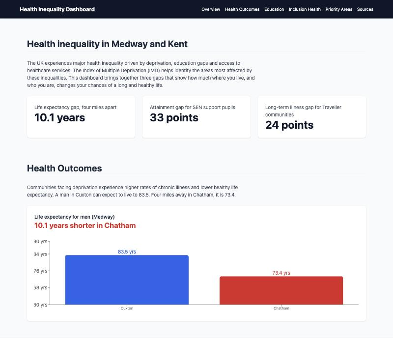

# Health Inequality Dashboard

[](https://github.com/Mubarakjk/health-inequality-dashboard/actions/workflows/ci.yml)

A dashboard that shows how much where you live, and who you are, changes your health in Medway and Kent.

**Live site:** https://mubarakjk.github.io/health-inequality-dashboard/



## What it shows

| Gap | Figure |
| --- | --- |
| Life expectancy for men in Cuxton and Chatham, four miles apart | 83.5 years against 73.4 years |
| Pupils meeting the expected Key Stage 2 standard | 26% of SEN support pupils in Medway against 59% of all pupils in England |
| People with a long-term condition | 42% of Gypsy, Roma and Traveller people against 18% of the general population |

It also covers what helps inclusion health groups engage with healthcare, and the areas where targeted work would make the biggest difference: Margate Central and Chatham.

## Why I built it

Health inequality is usually written about in long reports full of tables. The point is simple and should be easy to see: two places four miles apart, ten years of life between them. I built this to turn the numbers into something a person can understand in a few seconds.

## How it works

```
src/
  data.ts                 Every figure, next to the source it came from
  data.test.ts            Tests for the data and the gap calculation
  App.tsx                 The page: overview, three sections, priorities, sources
  components/
    GapChart.tsx          A reusable bar chart with a headline number
    Nav.tsx               Sticky navigation
    Section.tsx           A titled page section
```

### Decisions I made

- **Data lives in one file.** `data.ts` holds every number and the source it came from. Updating a figure means changing one line, and no chart has a number typed into it.
- **Headline numbers are calculated.** The "10.1 years" on the page is worked out from the data by a `gap` function, so it can never disagree with the chart beneath it.
- **One chart component.** All three charts use `GapChart`. Each takes a title, the data, a unit and a headline.
- **Charts work for screen readers.** A chart is only a picture to a screen reader, so each one has a hidden table with the same data.
- **Every figure has a source.** The Sources section links to the report or dataset behind each chart.

## Run it locally

You need Node.js 20 or newer.

```bash
git clone https://github.com/Mubarakjk/health-inequality-dashboard.git
cd health-inequality-dashboard
npm install
npm run dev
```

## Checks

```bash
npm test        # unit tests
npm run lint    # ESLint
npm run build   # type check and production build
```

GitHub Actions runs all three on every push and deploys the site only if they pass.

## Limits and next steps

- The figures are a snapshot taken from published reports. They are not loaded live.
- Next I would load ward-level data for the whole of Kent from the Office for National Statistics, and add a map so users can pick their own area.

## Tech

React 19, TypeScript, Vite, Tailwind CSS, Recharts, Vitest and GitHub Actions.

## Sources

- Institute of Health Equity, [Medway Marmot Place Partnership report](https://www.medway.gov.uk/download/downloads/id/9609/institute_of_health_equity_report_for_medways_marmot_place_partnership.pdf)
- Department for Education, [Key stage 2 attainment statistics](https://explore-education-statistics.service.gov.uk/find-statistics/key-stage-2-attainment)
- House of Commons Women and Equalities Committee, [Tackling inequalities faced by Gypsy, Roma and Traveller communities](https://publications.parliament.uk/pa/cm201719/cmselect/cmwomeq/360/report-files/36005.htm)
- Ministry of Housing, Communities and Local Government, [English indices of deprivation](https://www.gov.uk/government/collections/english-indices-of-deprivation)
